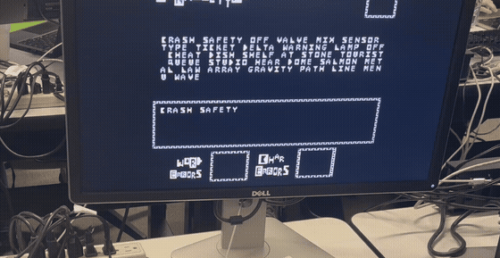
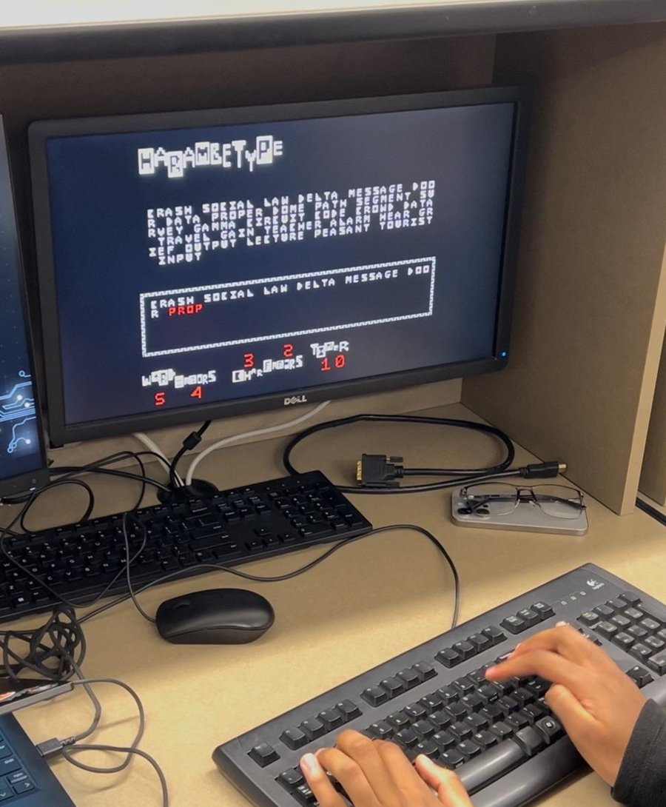
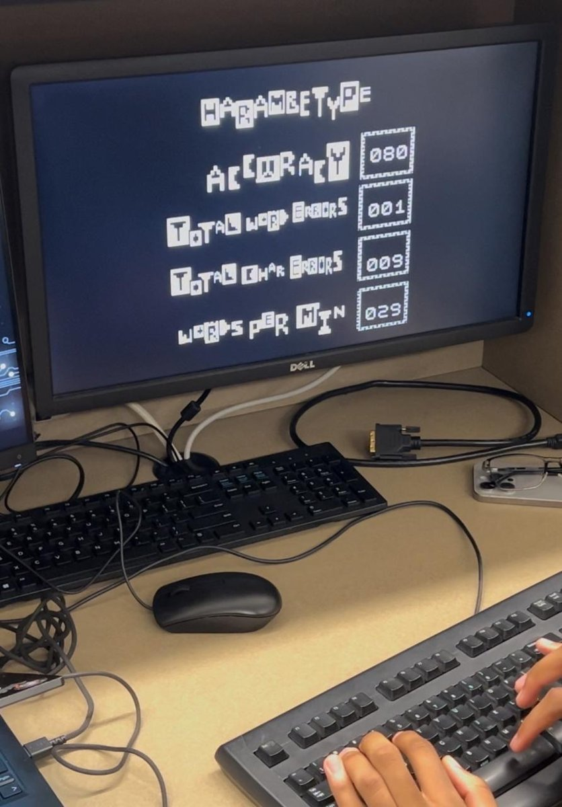
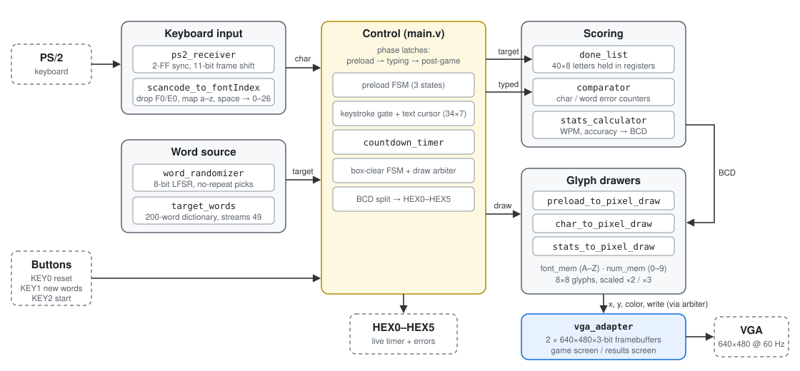
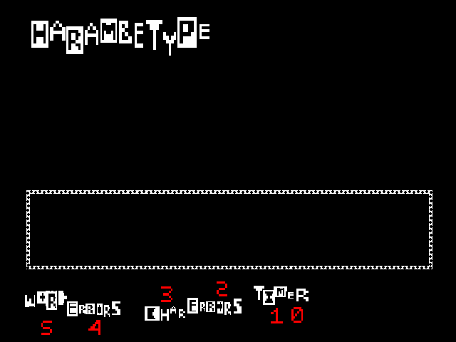
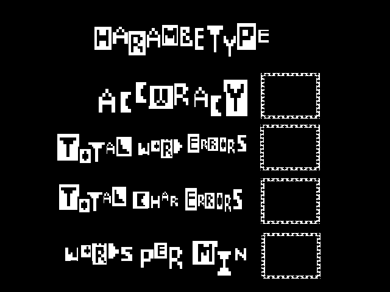
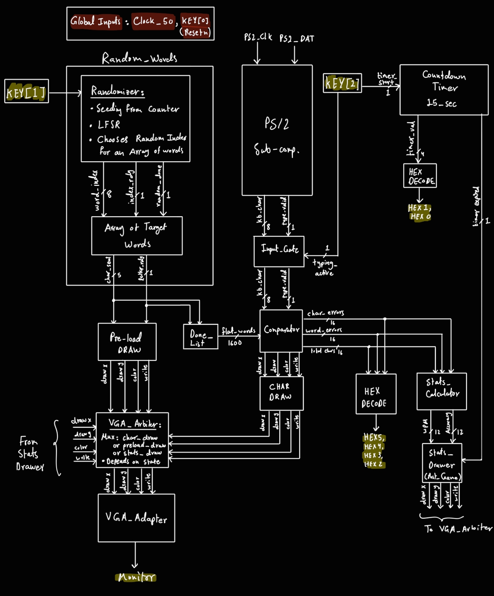
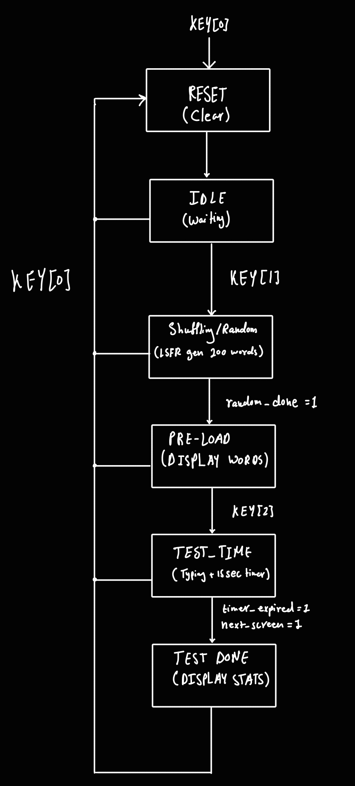

# HarambeType

**A [Monkeytype](https://monkeytype.com)-style typing test built in hardware on a DE1-SoC FPGA.**

There is no CPU or soft core in the design. Keyboard decoding, word shuffling, scoring and text rendering are all Verilog state machines, driving a 640×480 VGA display.


<p align="center">
  <a href="doc/media/demo.mp4"></a>
</p>

<p align="center"><em>Running on the board (click for the full video).</em></p>

---

## What it is

KEY1 shuffles a 200-word list and draws about 175 characters of target words. KEY2 starts a 15-second round, and every keystroke is scored live. When time runs out the display switches to a results screen.

- Random word order from an 8-bit LFSR, with no repeats
- Per-letter feedback: white if correct, red if wrong
- Live timer and error counts on the HEX displays
- Results screen with accuracy, word errors, character errors and WPM

<p align="center">
  
  &nbsp;
  
</p>

<p align="center"><em>A round in progress (the mistyped word in red) and the results screen.</em></p>

## Results

Post-fit, Quartus Prime 18.1 Lite, `5CSEMA5F31C6`:

| Resource | Used | Available | Utilization |
|---|---|---|---|
| Logic (ALMs) | 7,900 | 32,070 | **25%** |
| Registers | 3,090 | — | — |
| Block memory | 1,852,759 bits | 4,065,280 bits | **46%** |
| RAM blocks | 229 | 397 | **58%** |
| DSP blocks | 9 | 87 | 10% |
| PLLs | 1 | 6 | 17% |

Timing at 50 MHz is not met: Fmax is 17.6 MHz, with −36.8 ns worst setup slack, and there's no `.sdc` constraints file. It runs correctly on the board because the slowest paths (stats math and digit conversion) only change once per keypress.

Most of the logic is in `comparator` (4,713 ALMs, 60% of the design), which reads the target list through a runtime-indexed 1,600-bit bus, and `done_list` (1,160 ALMs), which keeps the target letters in registers. The two framebuffers account for nearly all of the block memory.

## Hardware and controls

| | |
|---|---|
| **Board** | Terasic DE1-SoC |
| **FPGA** | Intel Cyclone V `5CSEMA5F31C6` |
| **Display** | VGA, 640×480 @ 60 Hz, 3-bit color |
| **Input** | PS/2 keyboard (a–z, space) |
| **Clock** | 50 MHz `CLOCK_50`; 25 MHz pixel clock from PLL |

| Control | Action |
|---|---|
| `KEY0` | Reset |
| `KEY1` | Shuffle and draw new words |
| `KEY2` | Start a 15-second round |
| `HEX1:HEX0` | Seconds left |
| `HEX3:HEX2` | Character errors |
| `HEX5:HEX4` | Word errors |

---

## How it works

### Architecture

<p align="center">
  
</p>

| Module | Responsibility |
|---|---|
| `main` | Game-state flags, preload FSM, text cursor, box clearing, draw arbiter, HEX output |
| `ps2_receiver`, `scancode_to_fontIndex` | Keyboard frames in, letter codes out |
| `word_randomizer`, `target_words` | Shuffle and stream the target words |
| `done_list`, `comparator`, `stats_calculator` | Store the targets, score each keypress, compute WPM and accuracy |
| `*_to_pixel_draw` | Copy glyphs from ROM into the framebuffer |
| `vga_adapter` | Two framebuffers and VGA timing |

Modules talk to `main` through `valid` / `busy` / `done` handshakes.

### Game flow

KEY1 starts the shuffle and the preload together. The shuffle fills the word order far faster than letters can be drawn, so the preload FSM (`IDLE → WAIT_LETTER → WAIT_DONE`) requests one character at a time, waits for it to be drawn, and stops at a word boundary. KEY2 sets `typing_active` and starts the timer; keys are only accepted while it's set and no drawer or clear is busy. When the timer expires, `typing_active` drops, `nextScreen` switches to the results framebuffer, and the stats drawer runs exactly once (latched by `pg_draw_done`).

### Keyboard input

The keyboard drives its own PS/2 clock, which is asynchronous to the 50 MHz system clock, so sampling it directly risks metastability. `ps2_receiver` passes both PS/2 lines through 2-FF synchronizers first, then shifts in 11-bit frames on the synchronized clock's falling edge. `scancode_to_fontIndex` drops release (`F0`) and extended (`E0`) codes and maps a–z to 0–25 and space to 26, which are also the glyph positions in the font ROM.

### Picking words

`word_randomizer` runs an 8-bit LFSR seeded from a free-running counter, with a 200-bit used-word vector to prevent repeats. `target_words` keeps the first 49 picks, and the preload FSM copies each letter to the screen and into `done_list` for scoring.

### Scoring

`comparator` tracks the current word and letter on each keypress:

| Typed | Expected | Result |
|---|---|---|
| letter | same letter | advance |
| letter | different letter | +1 char error, word marked wrong |
| letter | end of word | +1 char error (extra letter) |
| space | end of word | next word, +1 word error if marked wrong |
| space | more letters | +1 char error per skipped letter, +1 word error |

A letter is drawn red if the char error count went up on that keypress. At the end of the round `stats_calculator` computes `correct = total − char_errors`, then `WPM = correct × 4 / 5` (5 characters per word, ×4 to scale 15 s to a minute) and `accuracy = correct × 100 / total`, and converts both to BCD.

### Drawing text

There's no text mode, so every glyph is copied pixel by pixel into the framebuffer. Three drawers (target text, typed text, stats) share one FSM: `IDLE → SETUP → READ → DRAW → NEXT_PX → NEXT_ROW → DONE`. Each reads an 8×8 glyph from ROM (letter *n* starts at address `n × 8`) and writes each lit pixel as a 2×2 block (3×3 for result digits), skipping background pixels. A glyph takes about 400 cycles, around 8 µs.

### Two framebuffers

Titles, labels and borders are preloaded from `.mif` images rather than drawn by logic. `vga_adapter` was modified to hold two 640×480 framebuffers, one for the game and one for results, selected by a single bit.

<p align="center">
  
  &nbsp;
  
</p>

A clear FSM wipes the text boxes on reset and when the typing box fills up, blocking keystrokes while it runs. Otherwise the arbiter gives the pixel bus to the text drawers during the game and the stats drawer after it.

---

## Repository layout

```
├── src/                  Final design, canonical source
│   ├── main.v                Top level: game flow, arbiter, clearing, HEX
│   ├── Input/                ps2_receiver, scancode_to_fontIndex
│   ├── Game/                 comparator, done_list, stats_calculator, timer, word_randomizer
│   ├── Memory/               target_words, font_mem, num_mem
│   ├── Drawing/              Glyph drawers
│   └── VGA_Adapter/          VGA adapter, modified for two framebuffers
├── project/              Quartus project, .mif images, prebuilt bitstream, reports
├── test/                 Icarus Verilog testbenches and Makefile
├── doc/                  Design diagrams, media, known issues
└── archive/              Milestone 1–3 code
```

## Build and run

Requires Quartus Prime 18.1 Lite, a DE1-SoC, a VGA monitor and a PS/2 keyboard.

To flash the prebuilt bitstream:

1. Connect over USB-Blaster and power on
2. Quartus → **Tools → Programmer**
3. Select `project/harambetype.sof`, then **Start**

To build from source, open `project/main.qpf`, run **Processing → Start Compilation**, and program the resulting `.sof` as above. Pin assignments are already in the `.qsf`.

## Simulation

Self-checking testbenches under `test/`, run with Icarus Verilog:

| Test | Covers | Result |
|---|---|---|
| `tb_input` | Real PS/2 frames through the receiver and decoder; releases, extended and unmapped keys ignored | PASS |
| `tb_comparator` | Perfect typing, typos, short words, extra letters | PASS, 2 XFAIL |
| `tb_target_words` | Each word shown is the one the randomizer picked | XFAIL |
| `tb_timer` | Round lasts 15 s (sped-up clock) | XFAIL |

```
cd test && make
```

XFAIL: the test checks correct behaviour and fails on a known bug.

---

## Design evolution

Our hand-drawn diagrams were the plan. The shipped design differs in three places: shuffle and preload run in parallel, `done_list` holds 40 words instead of 49, and a glyph takes ~400 cycles, not 64.

<p align="center">
  
  &nbsp;
  
</p>

Subsystem diagrams: [input](doc/diagrams/input_path.png) · [word source](doc/diagrams/word_source.png) · [scoring](doc/diagrams/scoring_path.png) · [rendering](doc/diagrams/render_path.png)

Milestone 2 used one framebuffer at 9-bit color, which took 86% of the RAM blocks. Adding a results screen meant a second framebuffer, and the only way to fit both was dropping to 3-bit color. Two 3-bit screens use 45% of block RAM; one 9-bit screen alone used 68%.

Things we would change ([details and fixes](doc/KNOWN_ISSUES.md)):

- **Widen the word address** to 11 bits so words 128–199 can appear.
- **Give each word 9 slots** so correct 8-letter words stop scoring as wrong.
- **Fix the timer**, which runs 16 s while WPM assumes 15.
- **Write background pixels in the drawers** so round 2's results don't overlap round 1's.
- **Pipeline the stats math and add an `.sdc`** to fix the 25 single-cycle dividers behind the timing failure.
- **Move the target list into block RAM**, since the comparator only needs one letter per keypress.

---

## Credits and license

Built by [@Synx162](https://github.com/Synx162) and [Philip Mugambi](https://www.linkedin.com/in/philip-mugambi-m/).

The VGA adapter, address translator and PLL are University of Toronto / Terasic DE1-SoC reference components, with `vga_adapter` modified to hold two framebuffers. The PS/2 receiver's synchronizer follows the course PS/2 demo.

MIT licensed. See [LICENSE](LICENSE).
